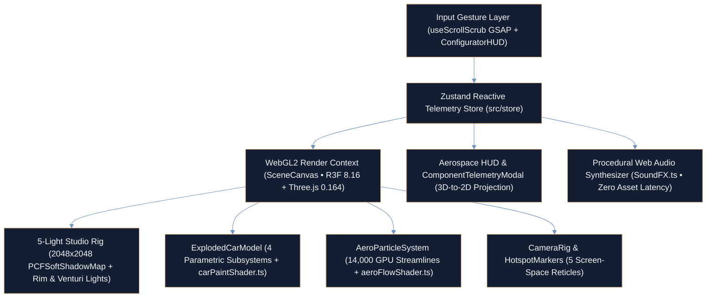

<div align="center">

# AETHER HYPERION GT — Bespoke 3D WebGL2 Electric Hypercar Experience

**Parametric Exploded Assembly, 14,000-Particle GLSL Aerodynamic Wind Tunnel & Procedural Web Audio Telemetry**

<p align="center">
  <a href="https://ayan-ai-engineer.vercel.app"></a>
  <a href="src/shaders"></a>
  <a href="src/components/canvas"></a>
  <a href="https://github.com/Ayan-Rajput-Analysis/aether-hyperion-3d"></a>
</p>

</div>

---

## Executive Summary

> **Governing Mandate:** Engineer a real-time, GPU-accelerated 3D automotive configurator and engineering schematic explorer combining custom WebGL2 vertex/fragment shaders, deterministic kinematic vector disassembly, and zero-latency procedural audio synthesis.

- **Parametric Multi-Tier Exploded Assembly:** Programmatically constructs and disassembles four mechanical subsystems (Outer Aero Shell, T1100 Carbon Monocoque, 120kWh SiC Powertrain, and Pushrod Carbon-Ceramic Suspension) along Hermite cubic-eased directional vectors driven by GSAP wheel/slider scrubbing.
- **Custom WebGL2 GLSL Shader Pipeline:** Pairs a dual-layer clearcoat micro-flake sparkle shader ([`carPaintShader.ts`](src/shaders/carPaintShader.ts), $\gamma = 180$ specular sharpness + Schlick Fresnel) with a **14,000-particle** real-time CFD wind-tunnel streamline shader ([`aeroFlowShader.ts`](src/shaders/aeroFlowShader.ts)) mapping stagnation pressure ($C_p \in [0, 1]$).
- **3D-to-2D Projected Telemetry & Procedural Web Audio:** Projects **5 screen-space HUD reticles** ([`HotspotMarkers.tsx`](src/components/canvas/HotspotMarkers.tsx)) synced with Zustand telemetry modals and a zero-asset Web Audio API synthesizer ([`SoundFX.ts`](src/audio/SoundFX.ts)) over a `2048x2048` `PCFSoftShadowMap` 5-light studio rig.

---

## System Architecture



### Mathematical & Shader Formulations

1. **Hermite Cubic Exploded Vector Interpolation:** Subsystems translate radially from the monocoque center of mass $\vec{C} = (0, 0.45, 0)$ as a function of continuous scrub progress $t \in [0, 1]$:

$$\vec{P}_{t} = \text{lerp}\left(\vec{P}_{\text{rest}}, \vec{P}_{\text{target}}, f(t)\right), \quad f(t) = t^2 \cdot (3 - 2t)$$

2. **Micro-Facet Metallic Flake & Dual-Layer Clearcoat ([`carPaintShader.ts`](src/shaders/carPaintShader.ts)):** Computes view-dependent micro-facet normal perturbations ($\gamma = 180$) combined with Schlick clearcoat Fresnel reflectance:

$$\vec{N}_{\text{flake}} = \text{normalize}\left(\vec{N}_{\text{base}} + (\text{hash}_3(\vec{P}_{\text{world}} \cdot s) \cdot 2 - 1) \cdot \kappa\right)$$

$$I_{\text{sparkle}} = \max\left(\vec{N}_{\text{flake}} \cdot \vec{H}, 0\right)^{180} \cdot \alpha_{\text{flake}}, \quad F(\theta) = F_0 + (1 - F_0)(1 - \cos\theta)^5$$

3. **Aerodynamic Stagnation Pressure Mapping ([`aeroFlowShader.ts`](src/shaders/aeroFlowShader.ts)):** Evaluates nose deflection and canopy suction across **14,000** GPU streamline particles:

$$C_p = \text{clamp}\left(1.2 \cdot P_{\text{nose}} - 0.6 \cdot P_{\text{canopy}} + 0.2,\ 0.0,\ 1.0\right)$$

---

## Capabilities & Subsystem Matrix

| Subsystem Module | Source Artifact | Architectural Responsibility & Rendering Spec |
| :--- | :--- | :--- |
| **Parametric Hypercar Assembly** | [`src/components/canvas/ExplodedCarModel.tsx`](src/components/canvas/ExplodedCarModel.tsx) | Programmatic 3D assembly of hood, butterfly doors, canopy, DRS wing, splitter, diffuser, T1100 carbon tub, 120kWh SiC pack & Brembo rotors |
| **CFD Wind Tunnel Engine** | [`src/components/canvas/AeroParticleSystem.tsx`](src/components/canvas/AeroParticleSystem.tsx) | 14,000 GPU-computed streamline particles transitioning between high-pressure stagnation (`Cp -> 1.0`) and low-pressure velocity zones (`Cp -> 0.0`) |
| **Micro-Flake Clearcoat Shader** | [`src/shaders/carPaintShader.ts`](src/shaders/carPaintShader.ts) | Custom GLSL vertex/fragment shader with 3D spatial hash flake normals and Schlick clearcoat specular highlights |
| **5-Point Studio Lighting Rig** | [`src/components/canvas/LightingRig.tsx`](src/components/canvas/LightingRig.tsx) | Bias-calibrated `2048x2048` `PCFSoftShadowMap` key light, cool horizon fill, silhouette rim spotlight, mode-reactive Venturi underbody light & PBR laser grid |
| **3D-to-2D Telemetry Reticles** | [`src/components/canvas/HotspotMarkers.tsx`](src/components/canvas/HotspotMarkers.tsx) | `@react-three/drei` projected reticles indexing `[01]` Shell, `[02]` Monocoque, `[03]` Powertrain, `[04]` Battery, and `[05]` Suspension |
| **Procedural Audio Engine** | [`src/audio/SoundFX.ts`](src/audio/SoundFX.ts) | Web Audio API oscillator/filter synthesis delivering zero-network-latency mechanical and HUD feedback |

---

## QA & Engineering Verification

- **Strict TypeScript Compilation Gate:** Production build (`tsc && vite build`) enforces type safety across React `18.3`, `@react-three/fiber` `8.16`, `three` `0.164`, and Zustand state slices (`tsconfig.json`).
- **Progressive Shader Pre-Warming:** [`src/App.tsx`](src/App.tsx) orchestrates an asynchronous graphics pipeline initialization barrier (`onLoaded`) so custom GLSL programs compile before first interactive scrub.
- **Zero External 3D/Audio Asset Bottlenecks:** Parametric geometry construction (`ExplodedCarModel.tsx`) and procedural Web Audio synthesis (`SoundFX.ts`) eliminate multi-megabyte `.glb` and `.wav` network stalls.
- **Damped Camera Choreography:** [`CameraRig.tsx`](src/components/canvas/CameraRig.tsx) pairs vector-damped `OrbitControls` with focal state transitions when inspecting individual mechanical subsystems.

---

## Tech Stack & Reproducible Quickstart

<p align="left">
  
  
  
  
  
  
  
  
  
</p>

### Core 3D Source Structure

```text
aether-hyperion-3d/
├── src/
│   ├── components/
│   │   ├── canvas/
│   │   │   ├── SceneCanvas.tsx          # WebGL2 R3F root canvas & shader pre-warm callback
│   │   │   ├── ExplodedCarModel.tsx     # Parametric 4-tier hypercar assembly & Hermite lerp
│   │   │   ├── AeroParticleSystem.tsx   # 14,000-particle GPU CFD wind tunnel streamlines
│   │   │   ├── LightingRig.tsx          # 5-light studio rig (2048x2048 PCFSoftShadowMap)
│   │   │   ├── HotspotMarkers.tsx       # 5 projected 3D-to-2D subsystem reticles
│   │   │   └── CameraRig.tsx            # Vector-damped OrbitControls & focal choreography
│   │   └── ui/                          # Header, ConfiguratorHUD & ComponentTelemetryModal
│   ├── shaders/
│   │   ├── carPaintShader.ts            # Micro-flake sparkle + Schlick clearcoat GLSL
│   │   └── aeroFlowShader.ts            # Stagnation pressure Cp streamline GLSL
│   ├── audio/
│   │   └── SoundFX.ts                   # Procedural Web Audio API synthesizer
│   ├── hooks/                           # useScrollScrub continuous GSAP wheel/slider binding
│   ├── store/                           # Zustand immutable telemetry & mode store
│   ├── App.tsx                          # Layered canvas + aerospace HUD orchestrator
│   └── main.tsx                         # React 18 DOM root mount
├── package.json                         # Three.js 0.164, R3F 8.16, Drei 9.105, GSAP & Vite
├── tsconfig.json                        # Strict TypeScript compiler configuration
└── vite.config.ts                       # Vite bundler configuration
```

### Local Execution

```bash
# 1. Clone the repository
git clone https://github.com/Ayan-Rajput-Analysis/aether-hyperion-3d.git
cd aether-hyperion-3d

# 2. Install dependencies (Node.js 18.18+ / 20+)
npm install

# 3. Start Vite development server
npm run dev

# 4. Verify TypeScript types & build production bundle
npm run build
```

---

<div align="center">

**[Live Author Portfolio (`ayan-ai-engineer.vercel.app`)](https://ayan-ai-engineer.vercel.app)** &nbsp;•&nbsp; **[LinkedIn](https://www.linkedin.com/in/ayan-rajput-8781a7397/)** &nbsp;•&nbsp; **[Email](mailto:ayanrajput779900@gmail.com)**

<sub>Architected &amp; Engineered by <a href="https://github.com/Ayan-Rajput-Analysis"><strong>Ayan Rajput</strong></a> • AI &amp; Deep Learning Engineer | 3D WebGL Specialist | Full-Stack &amp; BI Architect</sub>

</div>
